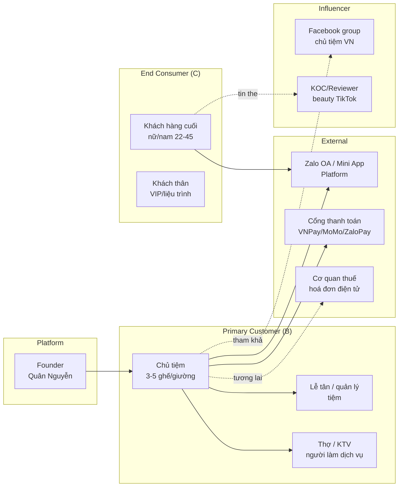

# Stakeholder Map + RACI — HếtChờ

**Mode**: Lite (giả lập)
**Ngày**: 2026-05-16

---

## 1. Stakeholder Map

---

## 2. Phân loại theo Power × Interest

| | **Quan tâm CAO** | **Quan tâm THẤP** |
|---|---|---|
| **Quyền lực CAO** | 🎯 Chủ tiệm (primary decision maker), Founder | Zalo Platform, Cổng thanh toán (đối tác, không config được) |
| **Quyền lực THẤP** | Khách cuối VIP/liệu trình, Lễ tân, Facebook group chủ tiệm | Cơ quan thuế (compliance, defer Phase 2), KOC beauty |

→ **Tập trung discovery vào Chủ tiệm + Khách VIP/liệu trình** (quadrant trên-trái).

---

## 3. RACI Matrix (cho dự án MVP)

| Quyết định | Founder | Chủ tiệm pilot | Lễ tân | Khách cuối | AI Agent |
|---|---|---|---|---|---|
| Tính năng MVP nào in/out | **A** | C | I | C | R |
| Pricing model (Phase 2) | **A** | C (phải hỏi) | I | C | R |
| UX dashboard chủ tiệm | A | **C (chính)** | C | I | R |
| UX khách đặt lịch (Zalo) | A | I | I | **C (chính)** | R |
| Cấu hình loại tiệm (ghế/giường/bàn) | A | **C** | C | I | R |
| Reminder timing (24h/2h trước) | A | **C** | C | C | R |
| Cọc giữ chỗ — mức nào, slot nào | **A** | **C** | I | C | R |
| Liệu trình tracking (số buổi) | A | **C** | C | C | R |
| Quyết định Public Launch M3 | **A/R** | I | I | I | C |

> **R** Responsible (làm) · **A** Accountable (chịu trách nhiệm cuối) · **C** Consulted (tham khảo) · **I** Informed (thông báo)

---

## 4. Recruitment Plan (cho interview thật ở Closed Beta)

> Lite mode hiện tại đang skip — nhưng template này để dùng khi M1 đến.

| Persona | Số lượng cần | Tiêu chí | Channel tuyển |
|---------|--------------|----------|---------------|
| Chủ tiệm salon tóc/barber | 2 | 3-5 ghế, ở HN/SG, dùng Zalo Pro | FB group "Hội Chủ Salon Tóc VN" |
| Chủ tiệm spa/massage | 2 | 3-5 giường, có khách liệu trình | FB group "Hội Chủ Spa & Skincare" |
| Chủ tiệm nail | 1 | 3-5 bàn, khách lễ Tết đông | FB group "Cộng đồng Nail Vietnam" |
| Chủ tiệm gội đầu dưỡng sinh | 1 | 3-5 ghế, nhiều khách regular | Outreach trực tiếp + giới thiệu |
| Khách cuối VIP/liệu trình | 3 | Nữ 25-40, đi spa/salon ≥ 1 lần/tháng | Network founder + giới thiệu từ chủ tiệm pilot |

**Compensation**: 200k voucher hoặc 1 dịch vụ miễn phí (cho khách cuối) / 1 tháng HếtChờ Pro miễn phí khi launch (cho chủ tiệm).
