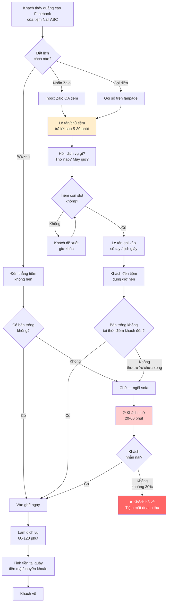
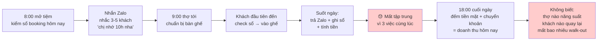

# 03 — As-Is Flow (Quy trình hiện tại)

> **Status**: Synthetic. Mô phỏng "tiệm nail 4 bàn, chủ Q.7 SG, dùng Zalo + sổ tay" — đại diện 60-70% tiệm target.

---

## 1. Customer Journey (Khách C → đến tiệm hôm nay)

---

## 2. Pain Points trong flow

| Bước | Pain | Frequency | Impact |
|------|------|-----------|--------|
| F (lễ tân trả lời chậm) | Khách Zalo bị bỏ 30 phút → khách inbox tiệm khác | Mỗi ngày 5-10 lần | Mất khách trước cả khi đặt |
| H (check slot manual) | Lễ tân nhìn sổ tay, không tính buffer giữa khách | Mỗi booking | 20% trùng lịch / khít quá |
| O (khách đến đúng giờ vẫn chờ) | Khách trước làm lâu hơn dự kiến → khách sau chờ | 30-40% booking | **Pain #1 — core problem** |
| Q (khách bỏ về) | 30% khách không nhẫn nại → walk-out | Mỗi ngày cao điểm | **Doanh thu mất 5-15tr/tháng** |

---

## 3. Operator Journey (Chủ tiệm — vận hành ngày)

### Tool stack hiện tại
| Tool | Dùng làm gì | Vấn đề |
|------|------------|--------|
| Sổ tay/lịch giấy | Ghi booking | Mất, ướt, không backup |
| Zalo OA cá nhân | Nhận booking | Inbox đầy, miss tin nhắn |
| Excel (1 số tiệm) | Doanh thu cuối tháng | Không realtime, ai cũng quên update |
| Sapo Salon (5% tiệm thử) | Booking + POS | Đắt (300-500k/tháng), giao diện rối, bỏ sau 1-2 tháng |
| Google Calendar (rất hiếm) | Cá nhân chủ tiệm | Không share với lễ tân, không realtime |

---

## 4. Top friction điểm cần giải pain trong MVP

| Pain | Ai chịu | Tần suất | Hệ quả tiền |
|------|---------|----------|-------------|
| **Khách chờ 20-60 phút → bỏ về 30%** | Khách + Tiệm | Hàng ngày cao điểm | Tiệm 4 bàn nail mất 5-15tr/tháng |
| **Lễ tân trả Zalo chậm → mất khách trước book** | Lễ tân + Chủ | Mỗi giờ | Khó đo, ước 2-5 booking/ngày |
| **Trùng lịch / khít quá** | Khách + Thợ | 1-2 lần/ngày | Khách cãi cọ, thợ stressed |
| **No-show không phạt được** | Tiệm | 5-10%/tuần | Tiệm 4 bàn mất 2-6tr/tháng |
| **Khách spa quên liệu trình** | Khách + Tiệm | 30% khách gói | Khách bỏ giữa chừng, gói còn dư |

→ **Tổng thiệt hại/tháng tiệm 4 bàn nail trung bình**: **~10-25 triệu/tháng** từ pain quản lý lịch.
→ Đây là **value proposition** mạnh: nếu HếtChờ giảm 50% thiệt hại = 5-12tr/tháng. Tiệm sẵn sàng trả 99-299k/tháng (Phase 2).
