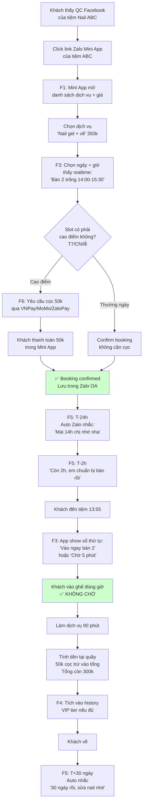

# 04 — To-Be Flow (Quy trình tương lai với HếtChờ)

> **Status**: Synthetic. Tương ứng MVP 6 feature trong Charter v1.0.

---

## 1. Customer Journey (Khách — đặt qua Zalo Mini App)

---

## 2. Operator Journey (Chủ tiệm — dùng dashboard web)

```mermaid
flowchart LR
    M1[8:00 mở app.hetcho.vn<br/>F2: Dashboard ngày] --> M2[Xem 8 booking hôm nay<br/>+ 3 booking có cọc]
    M2 --> M3[F4: Xem tier khách<br/>2 VIP ưu tiên slot]
    M3 --> M4[Auto: hệ thống đã<br/>nhắc khách lúc 8:00 sáng]
    M4 --> M5[Suốt ngày:<br/>F2 click checkbox xác nhận<br/>khi khách đến<br/>tự sync Google Cal]
    M5 --> M6[😊 Tập trung làm dịch vụ<br/>không bị Zalo ngắt]
    M6 --> M7[18:00 cuối ngày<br/>F2: Xem dashboard<br/>'Hôm nay 8 booking, 1 huỷ,<br/>doanh thu 2.4tr']
    M7 --> M8[F4: Xem<br/>'Chị Nga đã làm 7/10 buổi gói']
    M8 --> M9[F5: Click 'gửi recovery'<br/>cho 12 khách 30 ngày<br/>chưa quay lại]

    style M6 fill:#ccffcc
    style M9 fill:#ccffcc
```

### Tool stack mới
| Tool | Thay thế gì | Lợi ích |
|------|-------------|---------|
| Zalo Mini App tiệm | Inbox Zalo cá nhân | Khách self-service, lễ tân không trả tin nhắn |
| `app.hetcho.vn` Dashboard | Sổ tay + Excel | Realtime, multi-device, sync Google Cal |
| F3 Realtime queue | "Sổ tay + đoán" | Hết trùng lịch, hết khách chờ vô lý |
| F5 Auto reminder | Nhắn Zalo thủ công 3-5 lần/ngày | Tiết kiệm 30 phút/ngày |
| F6 Đặt cọc tự động | "Em hứa em đến" | Giảm no-show 50-70% |
| F4 Liệu trình tracker | "Để em xem sổ" | Khách + tiệm cùng track |

---

## 3. KPI cải thiện (giả định, cần verify)

| KPI | As-Is | To-Be (MVP) | Cải thiện |
|-----|-------|-------------|----------|
| Khách walk-out vì chờ | 30% peak | < 10% peak | -67% |
| No-show booking online | 15-20% | 5-7% | -65% |
| Lễ tân trả Zalo | 5-30 phút | 0 (self-service) | -100% |
| Thời gian chủ tiệm quản lý lịch/ngày | 60-90 phút | 10-15 phút | -85% |
| Recovery khách cũ 30/60/90 ngày | 0% (không làm) | 25-40% reply | +∞ |

→ **Validate trong Closed Beta M1**.

---

## 4. UX Principles (cho Phase 4 Tech Lead + designer)

1. **Chủ tiệm không rành tech** → Dashboard không quá 3 click cho mọi tác vụ chính. Mobile-first.
2. **Khách quen Zalo** → Mini App không cần download. Login 1-tap qua Zalo ID.
3. **Realtime là core USP** → F3 phải hiển thị slot trống/giây, không delay.
4. **Cọc là pain UX** → Explain rõ "trừ vào tổng bill, không mất tiền", show progress bar khi thanh toán.
5. **Multi-tenant nhưng khách cảm giác mua tại tiệm ABC** → Brand "powered by HếtChờ" nhỏ ở footer, brand tiệm to ở header.
