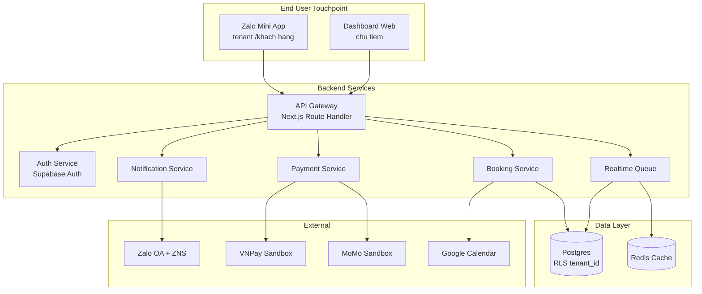
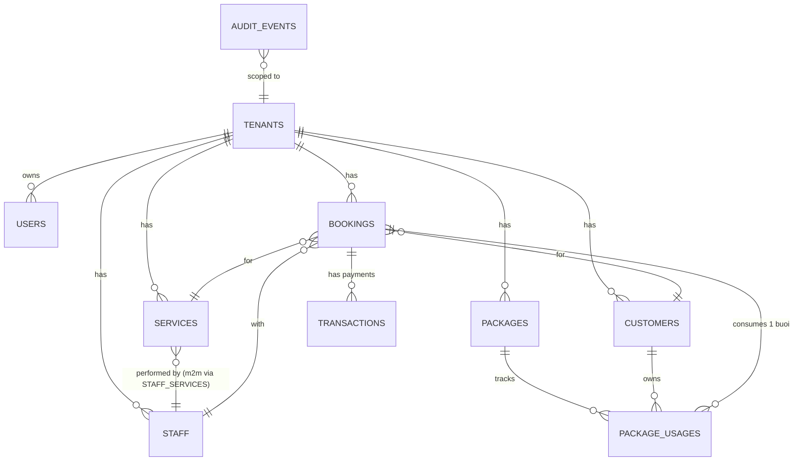
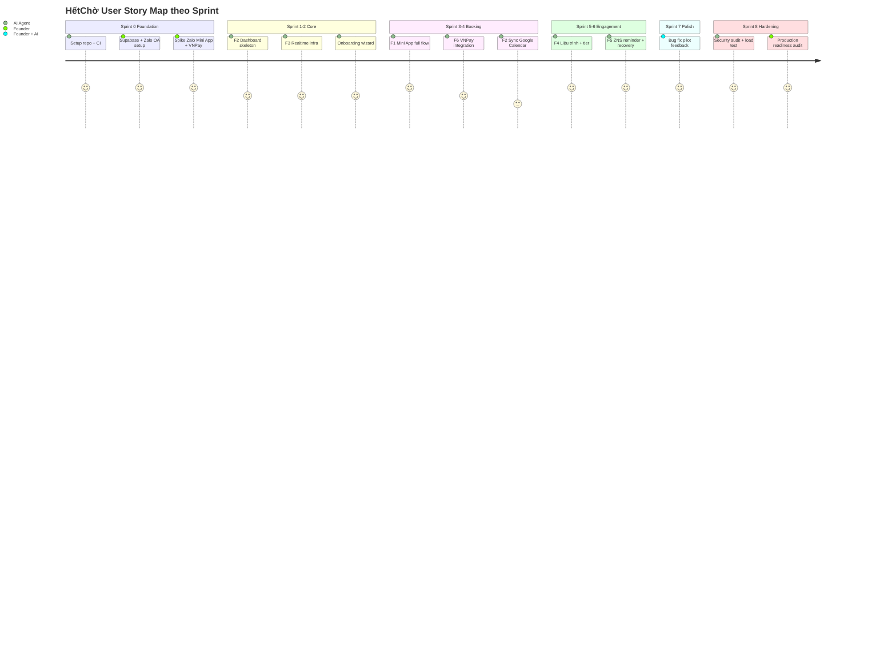

# Software Requirements Specification — HếtChờ

**Phiên bản**: 1.0
**Ngày phát hành**: 2026-05-16
**Tác giả**: AI BA (skill `requirements-documentation`)
**Tham chiếu**: BRD v1.0, Project Charter v1.0, Discovery output (docs/discovery/)
**Trạng thái**: ✅ Draft — chuyển Tech Lead Phase 4 review

---

## 1. Giới thiệu

### 1.1 Mục đích tài liệu
SRS này định nghĩa **chi tiết functional + non-functional requirement** đủ cho developer (solo founder + AI agent) build MVP 6 feature trong 18 tuần.

### 1.2 Scope tham chiếu
- Project Charter v1.0 → § Mục tiêu, Scope, Timeline
- BRD v1.0 → § Business pain, KPI, Constraints
- Discovery output → § Persona, User flow, Pain ranking

### 1.3 Audience
- **Primary**: Solo founder + Claude Code agent (executing skills: `senior-developer`, `tdd`, `frontend-design`)
- **Secondary**: Future hire (nếu Phase 2 tuyển team)

---

## 2. Tổng quan Hệ thống

### 2.1 Kiến trúc Multi-tenant SaaS

### 2.2 Multi-tenancy Strategy
- **Tenant**: 1 tenant = 1 tiệm.
- **Data isolation**: Row-Level Security (RLS) trên Postgres bằng cột `tenant_id` ở mọi bảng business.
- **URL**: `hetcho.vn/<tenant_slug>` cho khách, `app.hetcho.vn` (đăng nhập → dashboard riêng) cho chủ tiệm.
- **Zalo OA**: Mỗi tiệm có Zalo OA riêng — Mini App embed tenant_id qua query string.

---

## 3. Actors & Roles

| Actor | Mô tả | Quyền hạn |
|-------|-------|----------|
| **Khách C** (Customer) | Khách hàng cuối đặt lịch | Xem tiệm public, đặt lịch, trả cọc, xem lịch sử của mình |
| **Chủ tiệm** (Owner) | Decision maker tiệm | Toàn quyền với tenant: CRUD dịch vụ, thợ, lịch, xem báo cáo |
| **Lễ tân** (Receptionist) | Daily operator | CRUD lịch, xác nhận khách đến, không xem doanh thu |
| **Thợ/KTV** (Stylist) | Người làm dịch vụ | Xem lịch của mình, mark "đang phục vụ" / "done" |
| **System** | Cron job + webhook | Auto reminder, recovery campaign, payment webhook |

---

## 4. Functional Requirements

> Mỗi feature có User Stories format **"Là [Actor], tôi muốn [Action], để [Benefit]"** + Acceptance Criteria Given-When-Then.

---

### F1 — Zalo Mini App Booking

#### US-F1-001: Khách chọn dịch vụ
**Là** Khách C, **tôi muốn** xem danh sách dịch vụ + giá của tiệm trong Zalo Mini App, **để** chọn dịch vụ cần đặt.

**Acceptance Criteria:**
- AC1: Given khách mở Mini App tiệm ABC qua Zalo, When app load, Then hiển thị < 2s danh sách dịch vụ (tên, giá, thời lượng, ảnh).
- AC2: Given danh sách > 20 dịch vụ, When load, Then có filter theo category (Tóc / Nail / Spa…).
- AC3: Given khách chọn dịch vụ A, When click, Then chuyển sang bước chọn thợ.

**Priority**: Must Have | **Points**: 5

#### US-F1-002: Khách chọn thợ + giờ
**Là** Khách C, **tôi muốn** chọn thợ + giờ trống cụ thể, **để** đặt lịch chính xác.

**Acceptance Criteria:**
- AC1: Given khách chọn dịch vụ "Nail gel" 90 phút, When vào bước chọn thợ, Then hiển thị danh sách thợ làm được nail (filter theo `service_id`).
- AC2: Given chọn thợ A + ngày T7, When chọn ngày, Then hiển thị slot 15 phút từ 8:00 → 22:00, slot bận đánh dấu xám.
- AC3 (Edge case): Given 2 khách chọn cùng slot trong 30s, When người sau confirm, Then API trả 409 "Slot vừa bị đặt, vui lòng chọn slot khác".
- AC4: Given khách chọn slot, When confirm, Then check tier cao điểm — nếu cao điểm → bước F6 đặt cọc; nếu thường → confirm luôn.

**Priority**: Must Have | **Points**: 8

#### US-F1-003: Xác nhận booking
**Là** Khách C, **tôi muốn** thấy tóm tắt booking trước khi confirm, **để** kiểm tra lại.

**Acceptance Criteria:**
- AC1: Hiển thị: tiệm, dịch vụ, thợ, ngày-giờ, thời lượng, giá ước tính, mức cọc (nếu có).
- AC2: Sau khi confirm, gửi Zalo OA notification "Đặt thành công, mã booking #ABC123".
- AC3: Lưu vào lịch sử của khách trong Mini App.

**Priority**: Must Have | **Points**: 3

---

### F2 — Dashboard Chủ tiệm

#### US-F2-001: Đăng nhập tenant
**Là** Chủ tiệm, **tôi muốn** đăng nhập app.hetcho.vn, **để** quản lý tiệm của mình.

**Acceptance Criteria:**
- AC1: Email + password. Magic link option.
- AC2: Hỗ trợ Zalo OAuth (Phase 2 nếu Supabase Auth hỗ trợ).
- AC3: Sau login → redirect dashboard tenant của user (multi-tenant: user có thể own nhiều tiệm trong tương lai, MVP = 1-1).

**Priority**: Must Have | **Points**: 5

#### US-F2-002: Xem lịch ngày/tuần
**Là** Chủ tiệm, **tôi muốn** xem lịch ngày + tuần với grid timeline, **để** biết booking sắp tới.

**Acceptance Criteria:**
- AC1: Grid view: trục Y = thợ (3-5 thợ); trục X = giờ (8h-22h, slot 30 phút).
- AC2: Booking hiển thị block màu theo trạng thái: pending / confirmed / in-progress / completed / cancelled / no-show.
- AC3: Click block → modal detail (khách, dịch vụ, cọc, ghi chú).
- AC4: Tuần view: 7 cột ngày × thợ aggregate.
- AC5 (Mobile): Responsive, vuốt ngang để chuyển ngày.

**Priority**: Must Have | **Points**: 13

#### US-F2-003: CRUD dịch vụ + thợ + cấu hình tiệm
**Là** Chủ tiệm, **tôi muốn** khai báo loại tiệm (salon/spa/nail/gội đầu), dịch vụ, thợ, **để** hệ thống phù hợp với mình.

**Acceptance Criteria:**
- AC1: Onboarding: chọn loại tiệm → preset slot name (ghế / giường / bàn nail).
- AC2: Thêm dịch vụ: tên, mô tả, giá, thời lượng, category, ảnh, requires_deposit (boolean), deposit_amount.
- AC3: Thêm thợ: tên, ảnh, dịch vụ làm được (many-to-many), giờ làm việc.
- AC4: Cấu hình giờ peak: ngày trong tuần + khung giờ → tăng deposit/giá.

**Priority**: Must Have | **Points**: 8

#### US-F2-004: Xác nhận khách đến
**Là** Lễ tân hoặc Chủ tiệm, **tôi muốn** mark "khách đã đến" / "đang phục vụ" / "xong", **để** track flow.

**Acceptance Criteria:**
- AC1: Mỗi booking có button state machine: confirmed → checked-in → in-service → completed.
- AC2: Click "completed" → mở dialog "thu tiền": auto tính (price - deposit_paid), nhập payment method (cash/transfer).
- AC3: Mark "no-show" sau 30 phút quá giờ booking mà chưa check-in → cọc về tiệm.

**Priority**: Must Have | **Points**: 5

#### US-F2-005: Sync Google Calendar 2 chiều
**Là** Chủ tiệm, **tôi muốn** booking auto sync sang Google Calendar cá nhân, **để** xem được trên điện thoại không cần mở dashboard.

**Acceptance Criteria:**
- AC1: OAuth Google trong settings.
- AC2: Mỗi booking tạo/update/delete → push sang Google Calendar tương ứng.
- AC3 (Pull): Event Google Calendar manual (chủ tiệm thêm) → tạo booking "blocked slot" trong HếtChờ.

**Priority**: Should Have | **Points**: 8

---

### F3 — Realtime Availability

#### US-F3-001: Khách thấy slot realtime
**Là** Khách C, **tôi muốn** thấy slot trống cập nhật realtime khi đang trong Mini App, **để** không đặt vào slot vừa bị người khác đặt.

**Acceptance Criteria:**
- AC1: Mini App subscribe Supabase Realtime channel tenant.bookings.
- AC2: Khi có booking mới hoặc cancel → slot grid update < 500ms.
- AC3 (Edge): Khi mất kết nối → hiển thị banner "Mất kết nối, đang khôi phục…", retry mỗi 5s.

**Priority**: Must Have | **Points**: 8

#### US-F3-002: Dashboard tiệm realtime
**Là** Chủ tiệm, **tôi muốn** dashboard auto refresh khi có booking mới từ khách, **để** không phải F5 thủ công.

**Acceptance Criteria:**
- AC1: Dashboard subscribe channel tương tự AC1 F3-001.
- AC2: Booking mới hiện ngay + toast "Có booking mới từ <tên khách>".
- AC3: Counter trên header: "X booking hôm nay".

**Priority**: Must Have | **Points**: 5

---

### F4 — Customer Tier + Liệu trình

#### US-F4-001: Tier khách (Normal/CIP/VIP)
**Là** Chủ tiệm, **tôi muốn** phân hạng khách Normal/CIP/VIP, **để** ưu tiên slot.

**Acceptance Criteria:**
- AC1: Default tier = Normal. Tier upgrade rule cấu hình được: ≥ 10 booking → CIP, ≥ 50 booking + 30tr lifetime spend → VIP.
- AC2: Mini App khách VIP có "Slot ưu tiên" (slot khóa cho VIP 2h trước peak).
- AC3: Dashboard show tier badge bên cạnh tên khách.

**Priority**: Should Have | **Points**: 5

#### US-F4-002: Tracking liệu trình (gói buổi)
**Là** Chủ tiệm spa, **tôi muốn** track khách mua gói 5/10 buổi, **để** không quên số buổi đã làm.

**Acceptance Criteria:**
- AC1: Chủ tiệm tạo gói "Gói chăm sóc 10 buổi" — gắn dịch vụ + tổng giá + số buổi.
- AC2: Khách book dịch vụ trong gói → tự trừ 1 buổi, không charge thêm.
- AC3: Mini App khách thấy progress bar "Đã làm 3/10 buổi" + ngày hết hạn gói.
- AC4: T-7 ngày trước khi hết hạn → auto Zalo nhắc.
- AC5: Hết buổi → đóng gói, khách book lại = mua gói mới hoặc trả lẻ.

**Priority**: Must Have | **Points**: 13

---

### F5 — Reminder + Recovery Zalo

#### US-F5-001: Reminder T-24h và T-2h
**Là** System, **tôi muốn** auto gửi Zalo OA notification T-24h và T-2h trước booking, **để** giảm no-show.

**Acceptance Criteria:**
- AC1: Cron mỗi giờ check booking sắp tới — gửi qua ZNS (Zalo Notification Service) hoặc OA broadcast.
- AC2: Message template configurable per tenant: "{customer_name} chào em, mai {time} chị có lịch {service} tại {tenant}. Reply '1' để xác nhận, '2' để dời."
- AC3: Khách reply '1' → booking status confirmed. '2' → flag "request reschedule" cho dashboard.
- AC4: Audit log tất cả message đã gửi.

**Priority**: Must Have | **Points**: 8

#### US-F5-002: Recovery campaign 30/60/90 ngày
**Là** Chủ tiệm, **tôi muốn** auto nhắn khách cũ chưa quay lại sau 30/60/90 ngày, **để** kéo về.

**Acceptance Criteria:**
- AC1: Cron daily quét customers — last_booking_date == today - 30/60/90 ngày → trigger Zalo broadcast.
- AC2: Template configurable per milestone + per dịch vụ.
- AC3: Có voucher dynamic: 30 ngày "-5%", 60 ngày "-10%", 90 ngày "-15%".
- AC4: Dashboard report: bao nhiêu khách đã nhắn, bao nhiêu reply, bao nhiêu re-book.

**Priority**: Should Have | **Points**: 8

---

### F6 — Đặt cọc giữ chỗ

#### US-F6-001: Cấu hình cọc theo dịch vụ + slot
**Là** Chủ tiệm, **tôi muốn** cấu hình mức cọc theo dịch vụ + theo slot peak, **để** giảm no-show slot cao điểm.

**Acceptance Criteria:**
- AC1: Mỗi dịch vụ có 2 field: `deposit_normal` (default 0) và `deposit_peak` (default 50k).
- AC2: Slot peak = chủ tiệm cấu hình ở F2-003 AC4 (VD T7 14h-22h, CN cả ngày).
- AC3: Toggle "Yêu cầu cọc tất cả khách mới" để chủ tiệm bật/tắt.

**Priority**: Must Have | **Points**: 5

#### US-F6-002: Khách thanh toán cọc
**Là** Khách C, **tôi muốn** trả cọc nhanh trong Mini App, **để** giữ slot.

**Acceptance Criteria:**
- AC1: Sau khi confirm booking ở F1-003, nếu cần cọc → bước payment.
- AC2: Hiển thị options: VNPay (card/QR/ATM), MoMo, ZaloPay.
- AC3: Click option → redirect trang cổng → trả → callback về Mini App.
- AC4: Sau payment success → booking status = confirmed, cọc lưu trong `bookings.deposit_paid_at` + `transactions` table.
- AC5: Trong 5 phút mà chưa trả → slot tự release, booking cancelled.
- AC6 (Edge): Payment callback fail hoặc timeout → có cron 1 phút query VNPay/MoMo status để reconcile.

**Priority**: Must Have | **Points**: 13

#### US-F6-003: Xử lý cọc khi hoàn tất / no-show
**Là** System, **tôi muốn** xử lý cọc đúng business rule, **để** công bằng.

**Acceptance Criteria:**
- AC1: Booking completed → cọc trừ vào tổng bill (final_price = service_price - deposit_paid).
- AC2: Khách cancel ≥ 24h trước slot → cọc refund 100% (trừ phí cổng, ~3000đ).
- AC3: Khách cancel < 24h → cọc giữ lại tiệm (50% phạt nếu chủ tiệm bật rule).
- AC4: No-show (quá 30 phút không check-in) → cọc về tiệm 100%.
- AC5: Tiệm cancel (tiệm không thể phục vụ) → cọc refund 100%.
- AC6: Mọi rule trên configurable per tenant (chính sách hủy).

**Priority**: Must Have | **Points**: 8

---

## 5. Non-Functional Requirements

### 5.1 Performance
- API response < 200ms p95 (excl. payment redirect).
- Realtime push < 500ms từ database change đến client.
- Mini App initial load < 2s trên 4G (target market: VN cellular).
- Dashboard initial load < 3s desktop, < 4s mobile.

### 5.2 Scalability (target 12 tháng)
- Hỗ trợ 500 tiệm active concurrent.
- 50.000 booking/tháng.
- 1.000 concurrent realtime connection.

### 5.3 Availability
- 99.5% uptime (target — không phải 99.9% vì Supabase Free tier).
- Maintenance window: 1h sáng (giờ ít traffic).

### 5.4 Security
- HTTPS only.
- Postgres RLS enforce mọi query: user chỉ access dữ liệu tenant của mình.
- Payment data: KHÔNG lưu card info — chỉ lưu transaction_id từ cổng.
- Audit log table `audit_events` (append-only) cho mọi action critical (create booking, payment, cancel, refund).
- Rate limit: 100 req/min/IP cho public API, 30 req/min cho auth endpoints.
- Secret management: env vars qua Vercel/Supabase secrets, KHÔNG hard-code.
- PII (số điện thoại khách): hash khi log, mask khi hiển thị nhân viên cấp thấp.

### 5.5 Compliance
- Nghị định 13/2023/NĐ-CP (PDP):
  - Consent UI khi khách đăng ký lần đầu.
  - Endpoint `GET /api/me/export` (data export).
  - Endpoint `DELETE /api/me` (right to delete) với grace period 30 ngày.
- Thanh toán qua merchant có license NHNN (VNPay/MoMo/ZaloPay).

### 5.6 Usability
- Mobile-first cho cả Mini App + Dashboard.
- WCAG 2.1 AA accessibility cho dashboard.
- Tiếng Việt là default, code i18n-ready (English Phase 2).
- Onboarding chủ tiệm hoàn thành ≤ 10 phút (signup → tạo dịch vụ → có Mini App link).

### 5.7 Observability
- Sentry: error tracking + perf monitoring.
- Vercel Analytics: traffic + Web Vitals.
- Custom event tracking: bookings_created, payments_completed, no_shows — đẩy vào PostHog hoặc bảng `analytics_events`.
- Log aggregation: Better Stack hoặc Axiom.

---

## 6. Data Model (sơ bộ)

### 6.1 Bảng chính (tóm lược)

| Bảng | Key columns |
|------|-------------|
| `tenants` | id, slug, name, type (salon/spa/nail/...), settings JSON, created_at |
| `users` | id, email, tenant_id (nullable for super-admin), role (owner/staff/admin), zalo_id |
| `services` | id, tenant_id, name, duration_minutes, price, deposit_normal, deposit_peak, category |
| `staff` | id, tenant_id, name, photo_url, working_hours JSON |
| `staff_services` | staff_id, service_id |
| `customers` | id, tenant_id, name, phone (hashed), zalo_id, tier, lifetime_spend |
| `bookings` | id, tenant_id, customer_id, service_id, staff_id, start_at, end_at, status, deposit_required, deposit_paid_at, final_price |
| `packages` | id, tenant_id, name, total_sessions, validity_days, price |
| `package_usages` | id, package_id, customer_id, booking_id, used_at |
| `transactions` | id, tenant_id, booking_id, gateway (vnpay/momo/zalopay), amount, status, gateway_txn_id |
| `audit_events` | id, tenant_id, actor_id, action, entity, payload JSON, created_at (append only) |
| `notifications` | id, tenant_id, customer_id, channel (zns/oa), template, payload, sent_at, status |

**RLS Policy**: Mọi bảng có `tenant_id` → policy `tenant_id = auth.jwt() -> 'tenant_id'`.

---

## 7. Integration Specs

### 7.1 Zalo Mini App + OA
- **Mini App SDK**: Zalo Mini App JavaScript SDK (https://mini.zalo.me)
- **Login**: `zmp.getUserInfo()` → trả `zalo_id` → backend map sang `customers.zalo_id`.
- **Notification**: 2 luồng
  - **OA Broadcast** (cho promotion/recovery): rate limit 4 messages/customer/month.
  - **ZNS (Zalo Notification Service)**: cho transactional (booking confirmation, reminder), không giới hạn nhưng phí ~150-300đ/message.

### 7.2 Payment Gateway
- **VNPay**: REST API, sandbox `sandbox.vnpayment.vn`. Callback URL: `https://app.hetcho.vn/api/payment/vnpay/callback`.
- **MoMo**: REST API, sandbox `test-payment.momo.vn`. Callback URL: `https://app.hetcho.vn/api/payment/momo/callback`.
- **Idempotency**: callback có thể fire nhiều lần → dùng `gateway_txn_id` làm unique key.

### 7.3 Google Calendar
- OAuth 2.0 scope `https://www.googleapis.com/auth/calendar`.
- Sync via Webhook + manual reconcile cron daily.

---

## 8. API Endpoints (lược)

> Full OpenAPI spec sẽ generate ở Sprint 0 — đây là draft.

### Public API (Mini App, no auth required)
- `GET /api/public/tenants/:slug` — tenant info
- `GET /api/public/tenants/:slug/services` — danh sách dịch vụ
- `GET /api/public/tenants/:slug/availability?date=...&service_id=...` — slot trống
- `POST /api/public/bookings` — tạo booking (Zalo login required)

### Customer API (Zalo auth)
- `GET /api/me/bookings` — lịch sử booking
- `GET /api/me/packages` — gói liệu trình của mình
- `POST /api/me/bookings/:id/cancel` — cancel booking
- `POST /api/me/payments` — initiate payment

### Tenant API (Owner auth)
- `GET /api/tenant/dashboard?date=...`
- `POST/PUT/DELETE /api/tenant/services`
- `POST/PUT/DELETE /api/tenant/staff`
- `POST/PUT /api/tenant/bookings/:id`
- `POST /api/tenant/bookings/:id/checkin`
- `POST /api/tenant/bookings/:id/complete`

### Webhook
- `POST /api/webhooks/vnpay`
- `POST /api/webhooks/momo`
- `POST /api/webhooks/zalo-oa`

---

## 9. Cross-cutting Concerns

### 9.1 Error Handling
- API response chuẩn (xem `.claude/rules/architecture.md` §API Response Format).
- Custom error classes: `BookingConflictError`, `PaymentFailedError`, `TenantQuotaExceededError`...
- Sentry capture với context (tenant_id, user_id, booking_id) nhưng KHÔNG bao gồm PII.

### 9.2 Internationalization
- i18n-ready cho VI/EN từ Sprint 0 (next-intl hoặc i18next).
- MVP chỉ ship VI. EN copy ready cho Phase 2 launch quốc tế (nếu có).

### 9.3 Testing Strategy
- **Unit**: coverage ≥ 80% cho `services/`, `lib/`.
- **Integration**: API endpoint critical (booking create/cancel, payment flow).
- **E2E (Playwright)**: 3 happy path = "khách book + trả cọc", "chủ tiệm onboard", "no-show flow".
- **Manual UAT**: Chủ tiệm pilot dùng thật tại Closed Beta M1.

### 9.4 Deployment
- Vercel production: `app.hetcho.vn`
- Vercel preview: mỗi PR auto deploy.
- Supabase: 1 project staging + 1 project production.
- CI: GitHub Actions — lint → typecheck → test → preview deploy.
- Migration safety: skill `database-migration-safety` cho mọi migration prod.

---

## 10. Phụ lục — User Story Map

---

## 11. Sign-off & Change Control

| Vai trò | Tên | Ngày | Trạng thái |
|---------|-----|------|-----------|
| BA | AI BA | 2026-05-16 | ✅ Drafted |
| Founder | Quân Nguyễn | 2026-05-16 | ✅ Auto-approved (per autonomous mode) |
| Tech Lead | AI Tech Lead | (next phase) | 🔄 Pending |

**Change Control**: Mọi thay đổi sau v1.0 → bump version (v1.1, v1.2…) + log trong CHANGELOG.md cùng folder.

---

**Phát triển bởi Quân Nguyễn — Quality First, Always.**
