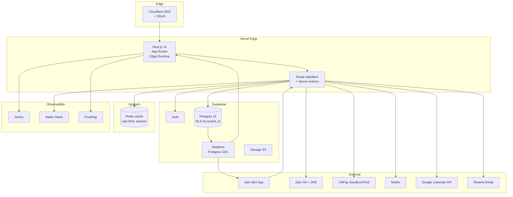

# Tech Decision — HếtChờ

**Phiên bản**: 1.0
**Ngày quyết định**: 2026-05-16
**Người quyết**: AI Tech Lead (skill `tech-lead`) — Founder Quân Nguyễn auto-approve theo autonomous mode
**Tham chiếu**: Charter v1.0 + SRS v1.0 + Discovery output

---

## 1. Tech Stack Cuối cùng

| Layer | Technology | Lý do chọn (rút gọn) |
|-------|-----------|---------------------|
| **Frontend Framework** | **Next.js 14 (App Router)** | SSR + RSC + edge runtime, ship nhanh, type-safe, Vercel hosting native |
| **Frontend Language** | TypeScript 5.x | Type safety, Quân Nguyễn rule (`coding-style.md`) |
| **UI Lib** | **Tailwind CSS 3 + shadcn/ui** | Component có sẵn, customize được, không bloat như MUI |
| **Mobile (Khách)** | **Zalo Mini App SDK** (zmp-sdk) | Charter requirement — Zalo-first. Không build native iOS/Android |
| **State Mgmt** | React Server Components + TanStack Query (client cache) | Tránh Redux overengineering |
| **Backend Runtime** | **Next.js Route Handler (Node 20)** + Server Actions | Monorepo Next FE+BE, deploy 1 nơi. Solo founder → simpler the better |
| **Database** | **PostgreSQL 15 (Supabase managed)** | RLS multi-tenant, JSONB cho settings, full-text search VN-ready |
| **Auth** | **Supabase Auth** (email + magic link, OAuth Google) | Built-in JWT + RLS integration. Zalo Mini App auth = custom provider |
| **Realtime** | **Supabase Realtime** (Postgres CDC over WebSocket) | F3 requirement — không phải tự build Socket.io |
| **Storage** | **Supabase Storage** (S3-compatible) | Ảnh dịch vụ, ảnh thợ. Bundled với Supabase free tier |
| **Cache** | **Upstash Redis** (serverless) | Free tier 10k req/day, không cần manage Redis cluster |
| **Payment** | **VNPay** (primary), **MoMo** + **ZaloPay** (Sprint 4+) | Phổ biến VN, license NHNN. ZaloPay tích hợp Mini App tốt |
| **Notification** | **Zalo OA Broadcast** + **ZNS (transactional)** | SRS §7.1 |
| **Email** | **Resend** (dev/prod), magic link only | Đơn giản hơn SendGrid, free tier 3k/tháng |
| **ORM/Migration** | **Drizzle ORM** (Postgres flavor) | Type-safe, lightweight, migration SQL trong sạch |
| **Validation** | **Zod 3** | Schema-first, dùng chung FE + BE |
| **Testing** | **Vitest** (unit + integration) + **Playwright** (E2E) | Vitest nhanh hơn Jest, ESM-native; Playwright > Cypress cho Mini App |
| **Linter/Formatter** | **ESLint 9** + **Prettier 3** | Quân Nguyễn rule |
| **CI/CD** | **GitHub Actions** + **Vercel auto-deploy** | Tích hợp tốt, free cho personal/solo |
| **Hosting** | **Vercel Pro** (app + APIs) | Edge runtime + analytics + preview URL mỗi PR |
| **DB Hosting** | **Supabase Pro** ($25/tháng từ Sprint 3+) | Pro để có daily backup + branching |
| **Error Tracking** | **Sentry** | Quân Nguyễn rule, free tier 5k events/tháng đủ pilot |
| **Logs** | **Better Stack** (Logtail) | Tail + search log, free tier OK |
| **Uptime** | **Better Stack Uptime** | Cùng vendor, ping 3 phút/lần |
| **Analytics (product)** | **PostHog Cloud** EU | Event tracking, funnel, session replay free tier |
| **Domain** | **`hetcho.vn`** (chính) + `app.hetcho.vn` (dashboard) | Phải đăng ký + check trademark (V-008) |
| **CDN/DNS** | **Cloudflare Free** (DNS + DDoS protection) | Trước Vercel edge |

---

## 2. Lựa chọn đã cân nhắc & Lý do bỏ

### 2.1 Backend Framework: Next.js vs NestJS vs FastAPI

| Tiêu chí | **Next.js Route Handler** | NestJS | FastAPI (Python) |
|---------|---------------------------|--------|------------------|
| Solo founder tốc độ | ✅✅✅ | ✅ | ✅✅ |
| Monorepo FE+BE | ✅ Native | ❌ Tách | ❌ Tách |
| Type safety end-to-end | ✅ Server Action | ✅ DTO | ⚠️ Pydantic OK |
| Deploy đơn giản | ✅ Vercel 1-click | ⚠️ Cần Docker | ⚠️ Cần Docker |
| Realtime native | ✅ qua Supabase | ⚠️ Cần Socket.io | ⚠️ Cần WebSocket lib |
| Quân Nguyễn template có sẵn | ✅ | ✅ | ✅ |
| **Quyết định** | ✅ **CHỌN** | ❌ | ❌ |

**Lý do chọn Next.js Route Handler thay vì NestJS**:
- Solo founder + 4.5 tháng → tách monorepo = overhead deploy/CI/version.
- Supabase đã giải quyết phần lớn backend (auth, DB, realtime, storage) → backend logic còn lại nhỏ → không cần framework nặng như NestJS.
- Clean Architecture vẫn áp dụng được qua folder structure (xem ADR-001).

### 2.2 Database: Postgres (Supabase) vs MongoDB vs MySQL

- ✅ **Postgres**: Multi-tenant RLS native, JSONB cho settings, full-text search VN, transaction mạnh cho payment.
- ❌ MongoDB: Multi-tenancy phải code thủ công, transaction yếu hơn → không phù hợp payment.
- ❌ MySQL: RLS không có, phải code app-level → dễ lỗ hổng security.

### 2.3 Realtime: Supabase Realtime vs Socket.io vs Pusher

- ✅ **Supabase Realtime**: Built-in, Postgres CDC, không phải maintain extra service. Lock-in chấp nhận được.
- ❌ Socket.io: Phải tự host (Render/Railway), thêm 1 service = phức tạp.
- ❌ Pusher: Có phí từ 49$/tháng, không tích hợp Postgres tự nhiên.

### 2.4 ORM: Drizzle vs Prisma vs raw SQL

- ✅ **Drizzle**: Lightweight, SQL-first (chủ tiệm Quân thấy được SQL gen), migration SQL clean.
- ❌ Prisma: Heavy generated client (3MB+), bundle bloat Vercel edge.
- ❌ Raw SQL: Phải tự type guard → mất type safety end-to-end.

### 2.5 Auth: Supabase Auth vs Clerk vs Auth.js

- ✅ **Supabase Auth**: Tích hợp RLS natural, free tier 50k MAU.
- ❌ Clerk: Đắt sau 5k MAU ($25/tháng + $0.02/MAU = 50k MAU = $925/tháng).
- ⚠️ Auth.js (NextAuth): Phải tự manage user table, không tích hợp RLS native.

### 2.6 Mobile khách: Zalo Mini App vs React Native vs PWA

- ✅ **Zalo Mini App**: Charter requirement. Khách quen Zalo, không cần download.
- ❌ React Native: Solo founder build app = +3-4 tháng, ASO khó.
- ⚠️ PWA: Có thể bổ trợ cho dashboard, nhưng cho khách thì Mini App đã đủ.

---

## 3. Kiến trúc Tổng thể



---

## 4. Folder Structure

```
het-cho/
├── apps/
│   ├── web/                      # Dashboard chủ tiệm (Next.js)
│   │   ├── app/
│   │   │   ├── (auth)/login/
│   │   │   ├── (tenant)/[slug]/  # Multi-tenant route
│   │   │   │   ├── dashboard/
│   │   │   │   ├── services/
│   │   │   │   ├── staff/
│   │   │   │   ├── bookings/
│   │   │   │   ├── customers/
│   │   │   │   └── settings/
│   │   │   ├── api/              # Route handlers
│   │   │   │   ├── tenant/
│   │   │   │   ├── public/
│   │   │   │   ├── me/
│   │   │   │   └── webhooks/
│   │   │   └── (public)/[slug]/  # Public booking page (web fallback)
│   │   └── components/
│   └── mini-app/                 # Zalo Mini App (zmp-sdk)
│       ├── src/
│       │   ├── pages/
│       │   ├── components/
│       │   └── services/         # API client share schemas
│       └── app-config.json
├── packages/
│   ├── db/                       # Drizzle schema + migrations
│   │   ├── schema/
│   │   │   ├── tenants.ts
│   │   │   ├── bookings.ts
│   │   │   ├── services.ts
│   │   │   └── ...
│   │   ├── migrations/
│   │   └── seed.ts
│   ├── domain/                   # Pure business logic (no framework dep)
│   │   ├── booking/
│   │   │   ├── entities/
│   │   │   ├── services/
│   │   │   └── repositories.ts   # interfaces
│   │   ├── payment/
│   │   ├── customer/
│   │   └── tenant/
│   ├── infrastructure/
│   │   ├── repositories/         # Drizzle impl
│   │   ├── payment-gateways/     # VNPay / MoMo / ZaloPay
│   │   ├── notification/         # Zalo OA + ZNS
│   │   └── calendar/             # Google Calendar
│   ├── shared/
│   │   ├── errors/
│   │   ├── logger/
│   │   ├── validators/           # Zod schemas
│   │   └── utils/
│   └── ui/                       # shadcn/ui components shared
├── scripts/
│   ├── seed-tenant.ts            # Tạo tiệm demo
│   ├── backup.ts
│   └── migrate.ts
├── docs/
│   ├── adr/
│   ├── api/                      # OpenAPI spec
│   ├── brd/
│   ├── srs/
│   ├── discovery/
│   ├── tech-decision.md          (file này)
│   ├── implementation-plan.md
│   └── project-charter.md
├── .github/workflows/
│   ├── ci.yml
│   └── deploy.yml
├── package.json                  # pnpm workspace
├── turbo.json                    # Turborepo cache
└── pnpm-workspace.yaml
```

→ **Monorepo Turborepo + pnpm workspace** — share code (domain, ui, db) giữa `apps/web` và `apps/mini-app`.

---

## 5. Module Breakdown

| Module | Priority | Sprint |
|--------|----------|--------|
| `tenant` (onboarding, settings) | P0 | Sprint 0-1 |
| `auth` (Supabase + Zalo) | P0 | Sprint 0-1 |
| `services` + `staff` (CRUD) | P0 | Sprint 1-2 |
| `bookings` (CRUD + state machine) | P0 | Sprint 2-3 |
| `realtime` (availability + dashboard) | P0 | Sprint 2-3 |
| `payment` (VNPay) | P0 | Sprint 3-4 |
| `mini-app` (Zalo) | P0 | Sprint 3-4 |
| `notification` (ZNS reminder) | P0 | Sprint 5 |
| `recovery-campaign` (broadcast) | P1 | Sprint 5-6 |
| `tier` + `package-tracking` | P0 | Sprint 5-6 |
| `google-calendar-sync` | P1 | Sprint 4 |
| `reporting` (basic) | P1 | Sprint 6-7 |
| `observability` (Sentry, PostHog) | P0 | Sprint 0 (setup) |

---

## 6. Implementation Plan (link)

Chi tiết sprint plan → `docs/implementation-plan.md`.

---

## 7. Rủi ro Kỹ thuật & Mitigation

| # | Rủi ro | Khả năng | Impact | Mitigation |
|---|--------|---------|--------|-----------|
| TR1 | Zalo Mini App SDK quirks (auth, payment in-app limit) | Cao | Cao | Sprint 0 spike PoC. Fallback web (hetcho.vn/<slug>) nếu Mini App block. |
| TR2 | VNPay/MoMo merchant KYC chậm | TB | Cao | Đăng ký Sprint 0-1, mock gateway cho dev. |
| TR3 | Supabase free tier chạm trần (500MB DB) | TB ~M2 | TB | Upgrade Pro $25/m từ Sprint 3 trước Open Beta. |
| TR4 | RLS bug → leak data cross-tenant | Thấp | **Cực cao** | Unit test mọi query với 2 tenant; integration test cross-tenant scenario; security audit Sprint 8. |
| TR5 | Drizzle ORM migration conflict | Thấp | TB | Mọi migration qua skill `database-migration-safety`. |
| TR6 | Realtime mất kết nối Mini App (network 3G/4G) | Cao | TB | Retry với exponential backoff. Cache slot 30s qua Redis. |
| TR7 | Cron job miss (Vercel Cron không guarantee) | TB | TB | Dùng Vercel Cron + retry queue qua Upstash QStash. |
| TR8 | Solo founder rời tay → bus factor = 0 | Cao | Cực cao | Document everything. Code có test. AI agent có thể tiếp tục từ docs. |

---

## 8. Ngân sách Infra (ước tính)

| Service | Sprint 0-3 (dev) | Sprint 3+ (Closed Beta) | Open Beta + |
|---------|-----------------|------------------------|-------------|
| Vercel | Free | Pro $20/m | Pro $20/m |
| Supabase | Free | Pro $25/m | Pro $25/m |
| Upstash Redis | Free | Free | Pay-as-you-go ~$10/m |
| Sentry | Free | Free | Team $26/m |
| Better Stack | Free | Free | Free |
| PostHog | Free | Free | Free 1M events |
| Resend | Free | $20/m | $20/m |
| Cloudflare | Free | Free | Free |
| Zalo OA | Free | Free | ZNS ~150-300đ/msg |
| VNPay | Free setup | 0.5-2% mỗi giao dịch | 0.5-2% mỗi giao dịch |
| Domain hetcho.vn | ~1tr/năm | — | — |
| **Total/tháng** | **~0đ** | **~1.5-2 triệu** | **~3-5 triệu + variable** |

→ Trong budget 5-20tr/tháng anh đã commit. **Còn dư đủ cho marketing + KOC** Phase 2.

---

## 9. ADR (Architecture Decision Records)

- [ADR-001: Monorepo Turborepo, Next.js Route Handler thay vì NestJS](adr/001-monorepo-nextjs-route-handler.md)
- [ADR-002: Multi-tenant qua Postgres RLS](adr/002-multi-tenant-postgres-rls.md)
- [ADR-003: Realtime qua Supabase Realtime](adr/003-realtime-supabase.md)
- [ADR-004: Clean Architecture với folder `domain/`, `infrastructure/`](adr/004-clean-architecture-folders.md)

---

## 10. Tech Lead Sign-off

✅ **Tech Decision v1.0 approved (autonomous mode)** — Founder Quân Nguyễn auto-approve.

**Bước tiếp theo**:
1. Update `het-cho/CLAUDE.md` với stack đã chốt.
2. Tạo 4 ADR.
3. Founder verify PENDING_VERIFY.md V-001 đến V-007 trước Sprint 0 kick.
4. Sprint 0 (T1) bắt đầu: spike Zalo Mini App + VNPay + setup repo monorepo.

---

**Phát triển bởi Quân Nguyễn — Quality First, Always.**
